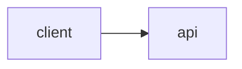

# URL shortener design

## 1. Requirements

**Functional**
-

**Non-functional** (with numbers)
-

**Out of scope**
-

## 2. Estimates

| Quantity | Value | Working |
| --- | --- | --- |
| Writes per second (avg / peak) | | |
| Redirects per second (avg / peak) | | |
| Storage after 5 years | | |

What these numbers imply:

## 3. API

```
POST /links
GET  /{code}
GET  /links/{code}/stats
```

## 4. Data model

## 5. High-level design



Walk through the write path, then the read path.

## 6. Deep dives

### Deep dive 1:

### Deep dive 2:

## 7. Trade-offs and failure modes

| Decision | Chose | Over | Because |
| --- | --- | --- | --- |
| | | | |

What breaks first as traffic grows 10x, and what you'd do about it:
