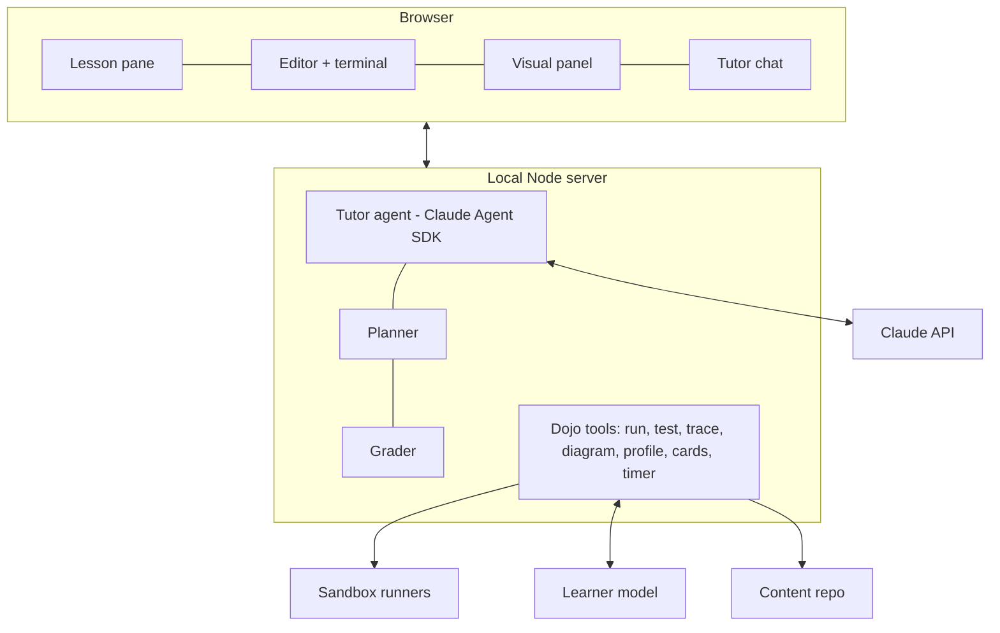

# Coding Dojo: spec

A training environment for software engineers: an AI tutor that sees your code, runs it, remembers your weak spots across every track, and plans each session around them. Utility first; no theme.

Status as of November 2026: **Phase 0 is built** (Claude Code skills + the `./dojo` CLI + 13 modules). Phases 1-3 describe the web app.

## Goals

1. Close gaps in fundamentals: system design, data structures and algorithms, testing, databases, concurrency.
2. Stay current on what matters most in AI engineering: context management, structured output, agents, retrieval, evals, MCP.
3. Be interview-ready on demand, including the newer AI-assisted coding rounds.
4. Learn by doing: every concept ends in code that runs, a test that passes, or a design the tutor critiques.

**Success:** 45 minutes a day with zero setup; an evidence-backed readiness score per track; finished exercises and mocks committed to your own repo.

## Build vs. buy

No single product covers this. The Dojo builds only what's missing (one tutor plus one learner model across every track) and uses or links to the rest.

| Need | Decision | Choice |
| --- | --- | --- |
| Tutor engine | Build on | Claude Code now; the Claude Agent SDK in the web app |
| Curriculum, rubrics, learner model, planner | Build | Files in Git plus a JSON (later SQLite) learner store |
| Code sandbox | Integrate | Docker with no network and resource limits (gVisor optional); E2B or similar for cloud; Pyodide/WebContainers for instant browser snippets |
| Spaced repetition | Integrate | FSRS via `ts-fsrs` |
| Visuals | Build and integrate | Own execution tracer and data-structure views; Excalidraw, Mermaid, marimo |
| Problem volume | Buy when interviewing | LeetCode Premium, Hello Interview; link out, never copy |
| Human mocks | Buy when interviewing | One or two sessions with working engineers before final rounds |

## Modes

| Mode | Use it for | Tutor acts as |
| --- | --- | --- |
| Today | One-click plan: reviews, then the highest-value lesson | Planner |
| Lessons | Brief → worked example with predictions → exercise with tests → recall check | Socratic teacher with a hint ladder |
| Free Play | Building, exploring, reviewing your own code; "save this" makes a card | Pair programmer |
| Interview Sim | Timed DSA, system design, AI-assisted, behavioral and code-review rounds with scorecards | Neutral interviewer |
| Review | 10-15 minutes of FSRS cards: recall, predict, spot the bug, complexity, re-solves | Examiner |
| Debrief | Weekly: what moved, what's slipping, next week | Coach |

## Tutor design

Three hard rules: verify by running; climb the hint ladder one rung at a time (nudge → name the pattern → pseudocode → code for the stuck part → full solution); write down what was learned about the learner every session.

Feedback always has the same shape: 1-4 per rubric dimension, one strength, the top two fixes, one next drill. Rubrics live in `content/rubrics/rounds.yaml`.

## Learner model

- **Skills** come from module files, with prerequisites and an interview weight.
- **Mastery** is an Elo-style rating per skill: `E = 1 / (1 + 10^((D − R)/400))`, `R' = R + K(s − E)`, where the attempt score `s` is pass ratio × hint discount (1, 0.85, 0.7, 0.5, 0.3, 0.1 by highest rung) × a time factor. K is 64 for the first three attempts, then 32. Displayed mastery is E against a medium problem.
- **Retention** is FSRS per card. Exercises finished at rung 5 schedule a "re-solve from a blank file" card in 3 days.
- **Planner:** due reviews first; then exercises ranked by track weight × interview factor × (1 − mastery) × prerequisite readiness × an in-progress bonus × an interleaving penalty for a third consecutive session on one track, fitted to the day's minutes.

## Sandbox

One interface, `run(exercise, solution, limits)`, with interchangeable runners:

| Runner | Status | Isolation |
| --- | --- | --- |
| Local Node process with timeout | Built | Process only; fine inside Claude Code's sandbox |
| Docker | Built | No network, read-only root, 1 CPU, 512 MB, 256 pids, all capabilities dropped; optional `runsc` (gVisor) |
| Cloud microVM (e.g. E2B) | Phase 3 | For phone or tablet sessions |
| Browser (Pyodide, WebContainers) | Phase 2 | Instant snippets and traces |

## Architecture (web app)

The engine in `src/` (content loader, learner model, planner, runner) is the shared core: the CLI uses it today and the server will import it unchanged.

## Roadmap

| Phase | Scope | Gate to move on |
| --- | --- | --- |
| 0. Dojo in a repo | Claude Code skills, `./dojo` CLI, learner model, FSRS, sandboxed tests, first system design, AI engineering and DSA modules | 5 sessions done |
| 1. Working app | Next.js app: Monaco editor, terminal, tutor chat via Agent SDK with Dojo tools, Lessons mode | 2 weeks of daily use |
| 2. See and rehearse | Execution stepper and data-structure views, complexity chart, Excalidraw design board, Interview Sim UI, Docker Compose system-design labs with fault injection | First 3 mock scorecards |
| 3. Deepen, go mobile | MCP server and Agent SDK modules, evals for the tutor itself, cloud sandbox and remote access, voice for mock interviews | Two tracks at "ready" |

## Risks

| Risk | Mitigation |
| --- | --- |
| Building the dojo replaces training in it | Phase 0 first; cap build time at one session in three |
| Tutor misjudges code | Rule 1: verify by running; tutor evals in Phase 3 |
| Tutor gives away answers | Hint ladder in the skills now; enforced in the tool layer in the app |
| Thin or wrong content | `npm run check` gates every module; briefs cite stable sources |
| Copyright | Link to outside problems; store only your attempts |
